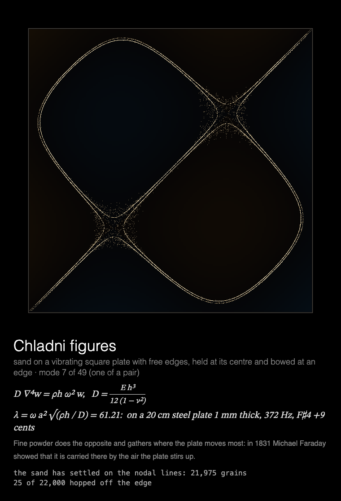

# MMM-Chladni

A [MagicMirror²](https://magicmirror.builders/) module that scatters sand on a vibrating square plate and lets it gather into Chladni figures, drawn for a Raspberry Pi without a GPU.



## What you see

**Chladni figures.** Sand scattered on a square plate with free edges; the plate sings one of its
modes, the grains hop off the parts that move and come to rest on the lines that don't, and the
figure appears. Then it holds. 49 figures, one per showing, all before any repeats.

Under the plate: the plate's equation, the mode's frequency parameter λ with the note a real
steel plate would sound, and one of five stories of the figures. The readout counts the grains still
hopping and those that have hopped off the edge.

Built for a **Raspberry Pi 3 without GPU acceleration**: everything is drawn by the CPU, the
modes are solved ahead of time, the module rests once the sand has settled, and the animation
stops while the module is hidden (see [Performance](#performance)).

## Installation

```bash
cd ~/MagicMirror/modules
git clone https://github.com/charleswest775/MMM-Chladni
```

No npm dependencies: there is nothing to install.

## Update

```bash
cd ~/MagicMirror/modules/MMM-Chladni
git pull
```

## Configuration

```js
{
	module: "MMM-Chladni",
	position: "middle_center",
	config: {
		cycleSeconds: 600,  // longer than the page is shown: one figure per showing
		width: 700,
		height: 700,
		fps: 12
	}
},
```

| Option | Default | Description |
|---|---|---|
| `chladniSeconds` | `14` | The longest the plate sings; it stops sooner once the sand has settled (8–12 s) |
| `chladniGrains` | `22000` | Grains of sand |
| `cycleSeconds` | `600` | Start a new figure this often; a new one also starts each time the module is shown again |
| `width`, `height` | `700` | Canvas size in pixels |
| `fps` | `12` | Frame-rate cap |
| `showMath` | `true` | Equations and live numbers under the canvas |
| `turns` | `null` | Take turns with other modules on the same page, e.g. `{ of: 2, at: 1 }` (see [Taking turns](#taking-turns)) |
| `statsPanel` | `false` | A line under the math showing what the mirror spends: fps, CPU of Electron and the compositor, a bar per core, temperature. Sampled by the module's `node_helper` from `/proc`, only while the module is shown |
| `debugStats` | `false` | Show achieved fps and per-frame timings in the corner of the screen |

## Taking turns

With `turns: { of: n, at: k }`, modules on the same [MMM-pages](https://github.com/edward-shen/MMM-pages)
page each show on their own one in n showings of it: `at: 0` on the first showing and every
nth after it, `at: 1` on the second, and so on. A module that isn't on its turn takes no room on
the page and costs nothing: it hides its canvas and doesn't start. So one slot in the rotation
can hold several pages, without making the rotation longer. For example, the Chladni figures and
[MMM-FractalZoom](https://github.com/charleswest775/MMM-FractalZoom)'s dives into the
Mandelbrot set, one per showing:

```js
{
	module: "MMM-FractalZoom",
	classes: "page-fractal",
	position: "middle_center",
	config: { turns: { of: 2, at: 0 } }
},
{
	module: "MMM-Chladni",
	classes: "page-fractal",
	position: "middle_center",
	config: { turns: { of: 2, at: 1 } }
},
{
	module: "MMM-pages",
	config: { modules: [["page-clock"], ["page-fractal"]], rotationTime: 30000 }
},
```

Without `turns` the module shows every time. It works just as well on a page of its own, or in
a normal region without MMM-pages, where it moves on to a new figure every `cycleSeconds`.

## What's real

Each showing scatters sand on a square plate with free edges and makes it sing one of its first
49 modes, up to λ = 470. Where the plate moves, its acceleration throws the grains up and they
land a little way off, more often downhill, away from the bigger motion; where it moves less
than a threshold it can't throw them, only nudge them onto the nodal line. So the sand leaves
the moving parts and draws the lines that stand still, in 8–12 s, and the figure holds. Grains
that hop off the edge fall off, as real sand does. Modes odd in x or y are still at the centre,
where Chladni held his plates and bowed them at an edge; the others are shaken at the centre,
as a vibrator does today. A pair of modes with the same frequency (one the other turned through
90°) makes two figures, their sum and difference. Under the sand, a faint tint shows the mode
itself: warm where the plate is up, cool where it's down.

The modes are solved by the method Walther Ritz invented for this very plate in 1909
(`simulations/plate.js`): the deflection as a mix of products of a free–free beam's modes,
X_m(x)X_n(y), 12 of each parity each way, with the mix that makes the plate's bending energy
stationary against its kinetic energy: a matrix eigenproblem for each of the square's four
parity classes. `node tools/chladni-modes.js` writes them to `data/chladni-modes.js`, so the
Pi doesn't solve anything. The tests check the frequencies against Leissa's *Vibration of
Plates* (13.468, 19.596, 24.270, 34.801, 61.093, 63.686 for ν = 0.3; all within 0.4%, from
above, as Ritz's method gives upper bounds), the shapes' symmetries, orthogonality, and that the
sand ends up on the nodal lines.

The caption gives λ = ωa²√(ρh/D) and what a 20 cm steel plate 1 mm thick would sound, with the
nearest note, and one of five stories: Chladni in 1787, Napoleon's prize and Sophie Germain's
win in 1816, Kirchhoff's edge conditions and Ritz, Faraday's powder that goes the other way,
and violin makers' glitter.

## Performance

Measured on a Raspberry Pi 3 B+ (Electron 42, software rendering), 700×700 at 12 fps over seven
showings, as CPU of the Electron processes plus the `cage` compositor with the stats panel on,
in % of one core (the Pi has four); baseline mirror without the module: 0.2%.

| | % of one core | achieved fps |
|---|---|---|
| module **hidden** (e.g. another MMM-pages page) | 0.3 | 0 |
| while the sand moves, the first ~12 s | ~108 | 11 |
| once it has settled | ~5 | 0 |
| over a 30 s showing, its page change included (~154 for the first 3 s) | 53 (47–61) | |

The sand is a pixel buffer, and each frame puts back only the rectangle of pixels whose grains
moved. While the sand moves that is most of the plate, ~75% of the canvas, for 8–12 s; then the
plate falls silent and the module rests.

Why it costs what it does, from micro-benchmarks on the Pi:

- There is no GPU acceleration to be had (the Pi 3's GPU only does GLES 2.0; Chromium needs
  3.0), so every pixel is drawn by the CPU.
- Any frame that changes the canvas costs ~2% of a core per fps, before drawing anything.
- On top of that, cost grows with the **area that changes**: Chromium redraws the bounding box
  of everything touched in a frame. So each frame puts back only the part of the plate where
  grains moved, and the frame rate is capped at 12.
- JavaScript is not the bottleneck: the modes are precomputed, so the Pi only moves the sand.
- The frame loop sleeps with `setTimeout` until a frame is due. Once the figure is finished the
  module rests, and is only polled twice a second. While MagicMirror² fades the module out,
  nothing new is drawn; once it is hidden, the loop stops.

## Development

```bash
node --test                  # plate and sand checks (no dependencies)
python3 -m http.server       # then open http://localhost:8000/dev/preview.html
node tools/chladni-modes.js  # re-solve the plate's modes into data/chladni-modes.js
```

`dev/preview.html` runs the module outside MagicMirror², in a portrait 1200×1920 frame, with
hide/show buttons that follow MagicMirror²'s suspend/resume order. Query options override the
config, e.g. `?figure=12` for one figure (1–49, by frequency), `&seed=1` to scatter the same sand
each time, or `?chladniGrains=40000`.

The tests check the free–free beam's frequencies and the orthonormality of its modes, the
plate's frequencies against Leissa's, the symmetries of the lowest modes, the data file against
a fresh solve, the notes a steel plate would sound, that the sand ends up on the nodal lines,
and that each showing brings the next figure of a shuffled deck.

## License

MIT

Part of a family of MagicMirror² modules:
[MMM-ChaosTheory](https://github.com/charleswest775/MMM-ChaosTheory),
[MMM-FractalZoom](https://github.com/charleswest775/MMM-FractalZoom),
[MMM-Atom](https://github.com/charleswest775/MMM-Atom),
[MMM-SacredGeometry](https://github.com/charleswest775/MMM-SacredGeometry),
[MMM-Tilings](https://github.com/charleswest775/MMM-Tilings),
[MMM-PlanetsDance](https://github.com/charleswest775/MMM-PlanetsDance),
[MMM-SnowCrystal](https://github.com/charleswest775/MMM-SnowCrystal),
[MMM-NightSky](https://github.com/charleswest775/MMM-NightSky) and
[MMM-PhotoDeck](https://github.com/charleswest775/MMM-PhotoDeck).
